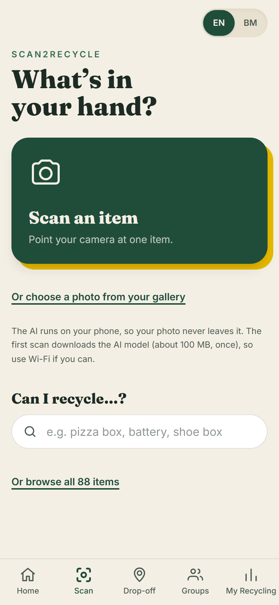
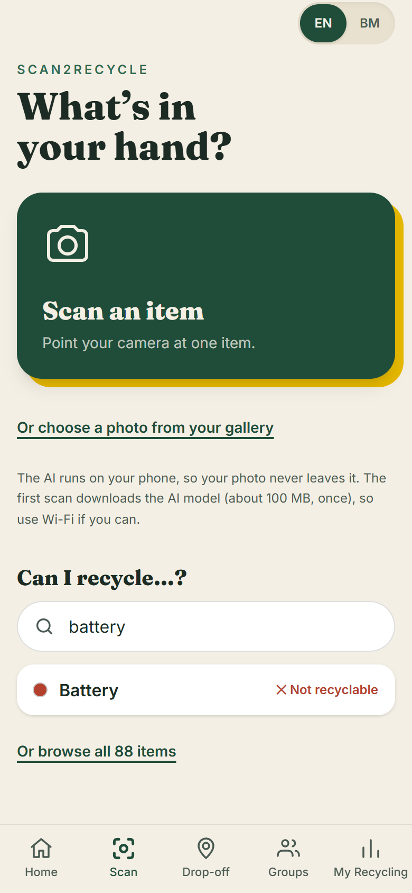
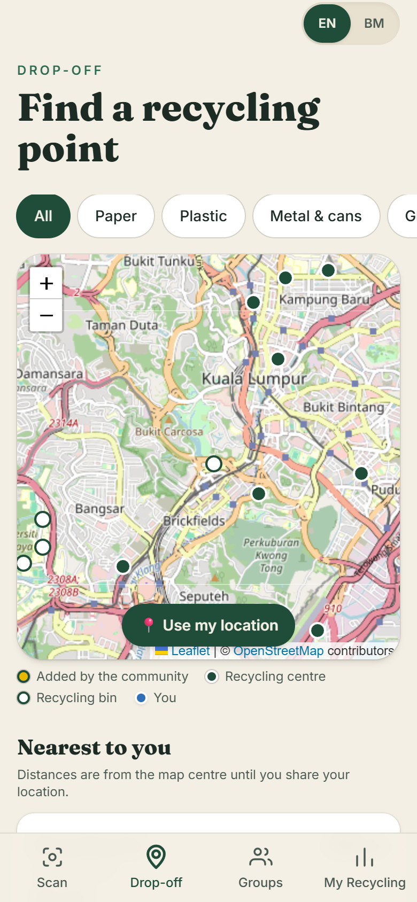
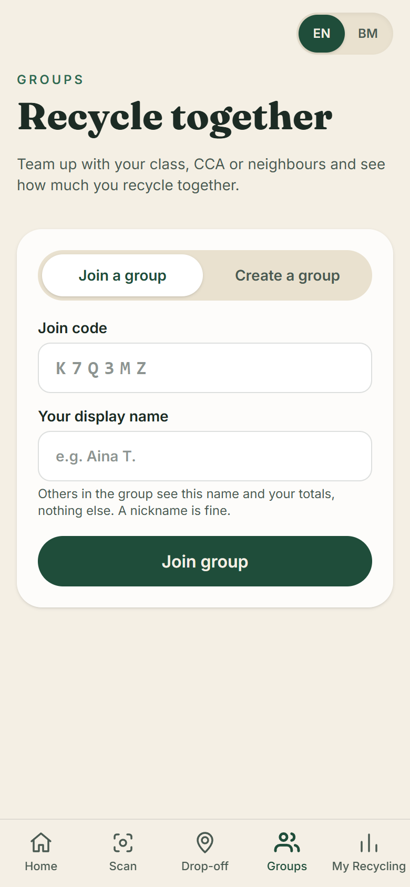
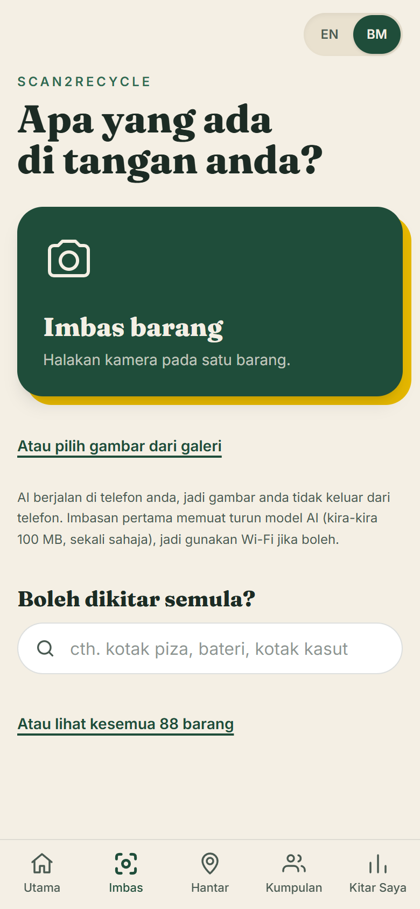

# Scan2Recycle

**Point your phone at an item, find out which bin it goes in, and keep track of what you recycle.**

Scan2Recycle is a free, installable web app (PWA) built for a Malaysian community-service project. An AI model that runs **on the phone** recognises everyday items, the app says whether each one is recyclable and which of Malaysia's coloured bins it belongs in, and then helps people take the next step: save the item with its weight, find a nearby drop-off point, and recycle together with a class or neighbourhood group.

**Live app:** <https://scan2-recycle.vercel.app> · **New here (person or AI)? Start with [HANDOFF.md](HANDOFF.md)**, and see [PLAN.md](PLAN.md) for the original plan and the measurements behind each decision.

## Screenshots

Phone-sized views of the app (English, plus the Bahasa Melayu switch on the right).

| Scan | Can I recycle…? | Drop-off map | Groups | Bahasa Melayu |
|:---:|:---:|:---:|:---:|:---:|
|  |  |  |  |  |

## Contents

1. [The problem and how the app helps](#1-the-problem-and-how-the-app-helps)
2. [Sustainable Development Goals (SDGs)](#2-sustainable-development-goals-sdgs)
3. [Features, screen by screen](#3-features-screen-by-screen)
4. [How it works](#4-how-it-works)
5. [Tech stack](#5-tech-stack)
6. [Data model and security](#6-data-model-and-security)
7. [Privacy](#7-privacy)
8. [Languages](#8-languages)
9. [Project structure](#9-project-structure)
10. [Setup](#10-setup)
11. [Scripts, tests and quality](#11-scripts-tests-and-quality)
12. [Limitations and roadmap](#12-limitations-and-roadmap)
13. [Credits and data sources](#13-credits-and-data-sources)

---

## 1. The problem and how the app helps

Most people want to recycle, but three small obstacles stop them:

| Obstacle | What usually happens | What Scan2Recycle does |
|---|---|---|
| **"Which bin is this?"** Rules are confusing: a greasy pizza box is paper but not recyclable, a drinking glass is glass but does not go in the glass bin, batteries must never go in a bin. | People guess, contaminate the recycling, or give up and use general waste. | Identifies the item from a photo (or a typed search), says whether it is recyclable, names the bin and shows its colour, and adds a short tip such as "Rinse and flatten" or "Never put batteries in bins". |
| **"Where do I take it?"** Items like e-waste, clothes and batteries need a drop-off point, and few people know where the nearest one is. | The item goes in the bin anyway, or stays in a drawer. | A drop-off map with filters per material, distances, and directions. Anyone can add a hub they know about, so the map keeps improving. |
| **"Does it make a difference?"** Recycling feels invisible. | Motivation fades. | Totals per material, a "you have diverted X kg" message, a daily streak, a weekly goal, and group leaderboards for classes or neighbourhoods. |

It is designed for **phones, schools and low-data situations**: it is free, needs no sign-up to start, works in **English and Bahasa Melayu**, and the AI runs on the device so photos are never uploaded.

## 2. Sustainable Development Goals (SDGs)

Scan2Recycle contributes mainly to **SDG 12** and supports three others. The table says what the app actually does for each goal. It does not claim measured outcomes, because the app has not yet been evaluated in a real rollout (see [Limitations](#12-limitations-and-roadmap)).

| SDG | Relevant target | How Scan2Recycle contributes |
|---|---|---|
| **12 Responsible Consumption and Production** (main goal) | 12.5 reduce waste through prevention, reduction, recycling and reuse; 12.8 information and awareness for sustainable lifestyles | Tells people exactly how to dispose of 88 common items, so more waste ends up in the right stream and less contaminates recycling. Tips encourage reuse and donation (clothes, books, toys). Logging weights makes recycling visible and measurable. |
| **11 Sustainable Cities and Communities** | 11.6 reduce the environmental impact of cities, including municipal waste management | The community drop-off map (OpenStreetMap points plus hubs added by residents) makes existing recycling infrastructure easier to find and use, and shows where it is missing. Groups let a class, CCA or neighbourhood recycle together. |
| **4 Quality Education** | 4.7 education for sustainable development | Every result is a small lesson (why a paper cup is not recyclable, why batteries are hazardous). Built for school use, in both national languages, with group leaderboards for friendly class competitions. |
| **13 Climate Action** | 13.3 education and awareness on climate mitigation | Behaviour change and awareness: recycling and composting divert waste from landfill. The app does **not** yet estimate CO₂ saved. That needs sourced emission factors and is on the roadmap. |

## 3. Features, screen by screen

### Scan: "What's in your hand?"
- **Camera or gallery.** Take a photo (rear camera) or pick one. Photos are checked (must be an image, not empty, at most 20 MB) and shrunk to 512 px before the AI sees them.
- **On-device AI.** The model compares the photo with the labels of the app's 88 items and returns a ranked list with confidence scores.
- **Three possible outcomes**, depending on how sure the model is:
  1. **Confident** (score of 60% or more): shows the answer straight away.
  2. **Possible** (10% to 60%): "Is it one of these?" with the top three guesses, each showing its material, so a wrong item name with the right material is still useful.
  3. **Unknown** (below 10%): "What is it made of?" lets the person pick the material.
- **Result card:** item name, material, recyclable yes/no, the bin to use with its colour, a tip, the AI's confidence, and a link to the drop-off map pre-filtered for that material. **"Not right? Change it"** is always available.
- **Items can be made of a recyclable material but still not recyclable.** A greasy pizza box is paper, but it goes to general waste. The app handles this per item.
- **Save to My Recycling** with an optional weight in grams (the box suggests a typical weight where known; comma or dot decimals accepted; between 0.1 g and 50 kg). Non-recyclable items are explained but not counted.
- Corrections are recorded (`was_corrected`) so the team can later measure how often the AI is wrong.

### Can I recycle…? (search)
Type an item in **English or Malay** (for example "pizza box", "kotak piza", "bateri") or browse all 88 items grouped by material. Search handles plurals, common Malay words and either language's item names, so it works without a camera and without the AI model.

### Drop-off map
- Leaflet map on OpenStreetMap tiles with recycling **centres**, **bins** and **community hubs**, plus a "You" marker once location is shared.
- **Filter by material:** paper, plastic, metal & cans, glass, e-waste, clothes, food & garden.
- **"Use my location"** (only when tapped; the position never leaves the phone) and **"Search this area"** after panning the map.
- A list sorted by distance with address, opening hours, accepted materials, and a **Directions** button (opens Google Maps).
- **Nearest available:** if nothing is within 8 km, the search widens to 60 km and the page says so. Points that do not list their materials are shown last with a note to check first.
- **Add a recycling hub:** drop a pin, name it, choose what it accepts, add hours and notes. It appears on the map for everyone straight away; up to 10 a day per person, and people can delete their own.
- Works even when the free OpenStreetMap servers are down (see [How it works](#4-how-it-works)).

### My Recycling
- **Total recycled** with the "you've helped divert X of recyclable waste" message and a note for items saved without a weight.
- **Streak and weekly goal:** days in a row with a saved item, and this week's kilograms against a goal of 0.5, 1, 2 or 5 kg (weeks start on Monday).
- **Material bars** in the real bin colours with weight and item counts.
- **History:** every saved item with date, weight and a delete button.
- **Account card:** "Save my progress" with an email and password so totals follow you to other phones, plus sign-in, forgot-password and sign-out.

### Groups
- **Create or join** a group with a 6-character code (for example `K7Q3MZ`; no 0/O/1/I so codes are easy to read out). Up to 10 groups each.
- **Leaderboard** for the last 7 days or all time, with medals, the group's combined total and an **Invite friends** button (native share sheet, or copies the invite).
- Members see **only display names and totals**: never emails or ids. A nickname is fine.

## 4. How it works

```
Phone browser (React PWA)
 ├─ UI thread ── photo ──► Web Worker: SigLIP vision model (Transformers.js, ONNX/WASM)
 │                          label vectors precomputed in public/label-embeddings.json
 ├─ Supabase (Postgres + Auth + Row Level Security), via the publishable key
 ├─ Hugging Face Hub: model files, downloaded once (~100 MB) and cached by the browser
 └─ OpenStreetMap: map tiles; recycling points from the Overpass API,
    plus a bundled snapshot of all Malaysian points (public/osm-points-my.json)
```

There is **no custom backend and no AI server**. The browser talks directly to the hosted services above.

### The scan pipeline
1. **Prepare the photo.** Decode (respecting EXIF rotation), shrink to at most 512 px, encode as JPEG.
2. **Load the model** in a Web Worker so the screen stays responsive. The first scan downloads about 100 MB (progress bar shown); later scans load from the browser cache.
3. **Embed the photo** with the SigLIP vision encoder.
4. **Compare with the labels.** Each item has a label such as "a plastic water bottle". The label vectors are **precomputed** (`npm run embed-labels`) and shipped as a small JSON file, so phones only download the vision half of the model. A label missing from that file is embedded on the device, which downloads the text half once.
5. **Score.** Cosine similarity between the photo and every label, scaled and passed through softmax (the same maths as CLIP/SigLIP zero-shot classification), with three prompt templates averaged per label for stability.
6. **Decide.** The thresholds above (60% / 10%) turn the scores into a confident answer, a short list of choices, or a manual material pick. The scan state machine is a pure, tested reducer.

**Measured accuracy:** on 145 TrashNet photos the top guess put an item in the right bin **81%** of the time, and the right bin was in the top three guesses **94%** of the time. TrashNet photos are cleaner than real phone photos, so real-world accuracy will be lower. That is why the interface leans on "Is it one of these?" and "Not right? Change it". Details are in [PLAN.md](PLAN.md) §4.3.

### Reliability of the drop-off map
Free OpenStreetMap (Overpass) servers are often slow or rate-limited, so the map is built to degrade gracefully: two Overpass servers tried in turn, results cached for 24 hours (stale cache used if the servers are down), a **bundled snapshot of 250 Malaysian points** that always shows, and community hubs from Supabase that are always included.

### Offline and installable
The app shell is precached by a service worker and can be installed to the home screen (Android Chrome: menu → Install app; iPhone Safari: Share → Add to Home Screen). The AI model is cached after the first scan. Saving, groups and loading the item list need a connection.

## 5. Tech stack

| Layer | Technology | Why |
|---|---|---|
| UI | **React 19**, **TypeScript 6**, **Tailwind CSS 4** | Fast, typed, mobile-first styling with a custom green/yellow palette and Fraunces + Inter fonts |
| Build and PWA | **Vite 8**, **vite-plugin-pwa** (Workbox) | Installable app. The 27 MB ONNX runtime is excluded from the precache and cached when first needed |
| AI | **Transformers.js** running `Xenova/siglip-base-patch16-224` (8-bit), in a **Web Worker** | Zero-shot image recognition with no server, no cost and no photo upload. New items need no retraining |
| Database and auth | **Supabase** (Postgres, Auth, **Row Level Security**) | Free tier, anonymous sign-in so people can start without an account, optional email and password |
| Map | **Leaflet 1.9** + **OpenStreetMap** tiles and the **Overpass API** | Free and keyless, with open data and community contributions |
| Hosting | **Vercel** (root directory `web`) | Auto-deploys on every push to `main` |
| Testing and linting | **Vitest** (165 tests), **oxlint**, `tsc` strict type-check | Pure logic is covered by unit tests |

## 6. Data model and security

| Table | Who can read | Who can write |
|---|---|---|
| `materials`, `item_types` (7 materials, 88 items, English and Malay columns) | everyone | team only (dashboard or SQL) |
| `recycling_logs` (one row per saved item) | own rows | own rows (insert, update, delete) |
| `recycling_points` (community hubs) | everyone | any signed-in user adds (max 10 a day, enforced by a trigger); delete own only |
| `groups`, `group_members` | members only | only through the functions `create_group`, `join_group`, `leave_group`; `group_leaderboard` returns display names and totals to members |

- **Every table has Row Level Security**, so the publishable key in the app is safe. The service-role (secret) key must never be put in the web app.
- Database CHECK constraints mirror the app's validation (weight between 0 and 50 kg, name lengths, allowed materials, join-code format), so bad data is rejected even if someone bypasses the app.
- Saved data belongs to an anonymous Supabase user kept in the browser. "Save my progress" links an email to that user so earlier scans are kept, and totals then follow the person to other phones.

## 7. Privacy

- **Photos never leave the phone.** The AI runs on the device; only the model files are downloaded.
- **Location stays on the phone.** It is requested only when the person taps "Use my location" and is never sent to a server.
- **Groups reveal only a display name and totals** to other members. No emails, no ids.
- No ads, no tracking scripts. The app uses Google Fonts and OpenStreetMap tiles, which receive normal web requests.

## 8. Languages

The whole interface switches between **English** (default) and **Bahasa Melayu** with the EN | BM toggle (remembered on the device). Item names, tips, material names and bin names switch too, and search understands both languages.

- All UI text lives in `web/src/i18n/en.ts` and `ms.ts`. TypeScript and a test fail the build if a Malay key is missing or a placeholder differs.
- Library code never returns English sentences. It returns a message key that the screen translates.
- Database text uses `*_ms` columns and falls back to English if a Malay value is missing.
- The Malay text was written with AI help and **should be reviewed by a native speaker before any launch.**

## 9. Project structure

```
supabase/                 Database schema (migrations/), starter data (seed.sql) and setup_all.sql (everything in one re-runnable file)
web/                      The app: React + Vite + TypeScript, installable PWA
  public/                 label-embeddings.json (precomputed AI label vectors), osm-points-my.json (map snapshot), icons
  scripts/                embed-labels.mts, snapshot-points.mts
  src/
    i18n/                 en.ts, ms.ts, translate.ts, localize.ts, I18nProvider
    lib/                  Pure logic and Supabase calls (accounts, logs, groups, totals, streaks, search, weight, image …)
      classifier/         Web Worker, client, model settings, similarity maths, decision rules
      places/             Overpass, snapshot, community hubs, distance and filtering helpers
    features/             Screens: scan, dropoff, groups, stats, history, account, setup
    hooks/                useLoad, useHashRoute, useGeolocation
docs/screenshots/         Images used in this README
```

Conventions: immutable updates, small files, and a Vitest test beside each piece of pure logic. See [HANDOFF.md](HANDOFF.md) for more.

## 10. Setup

### 1. Run the app locally
Needs Node.js 20+.

```bash
cd web
npm install
npm run dev
```

Open the URL it prints. If something isn't set up, the Scan page shows a **Setup check** card saying what's missing.

### 2. Database (Supabase)
1. Create a free project at <https://supabase.com>.
2. **SQL Editor** → paste and run `supabase/setup_all.sql` (everything in one file, safe to re-run). It ends by showing row counts: materials 7, item_types 88.
   (Same result as running `migrations/001_init.sql` … `005_languages_hubs.sql` in order, plus `seed.sql`.)
   Already set up earlier? Just run the newer files you haven't run yet (latest: `005_languages_hubs.sql`).
   **Run it in project `bvqctjqhcsuevcgzhyou`** (the browser address must contain it); the app ignores any other project.
3. **Authentication → Sign In / Providers** → turn on **Allow anonymous sign-ins** (needed to save scans).
   On the same page, under **Email**, turn **off "Confirm email"** so "Save my progress" works without an email service.
   (Supabase's built-in email only sends to your own team's addresses, 2 per hour. To keep confirmations on, set up
   custom SMTP, e.g. Resend or Brevo, under **Authentication → Emails → SMTP Settings**.)
4. **Project Settings → API Keys** → copy the Project URL and the **publishable** key (`sb_publishable_…`).
5. Copy `web/.env.example` to `web/.env.local` and paste them in. Restart `npm run dev`.

The **service_role / secret** key must never go in the web app.

> **Bins:** set to Malaysia's 3-colour public bins (blue paper, orange plastic & metal, brown glass). Edit them in
> **Table Editor → materials** if your area differs.

### Verification and password-reset emails
Supabase's built-in email only reaches your own Supabase organisation's addresses (2 an hour), so real users need a
free email service. Brevo's free plan sends 300 emails a day.
1. **Brevo** (<https://www.brevo.com>): sign up, verify a sender email address (**Senders, domains & IPs → Senders**),
   then **SMTP & API → SMTP** and generate an **SMTP key**. Note the login shown there.
2. **Supabase → Authentication → Emails → SMTP Settings**: enable custom SMTP, then fill in
   host `smtp-relay.brevo.com`, port `587`, username = the Brevo SMTP login, password = the SMTP key,
   sender email = the address you verified in Brevo, sender name `Scan2Recycle`.
3. **Supabase → Authentication → URL Configuration**: Site URL `https://scan2-recycle.vercel.app`; add Redirect URLs
   `https://scan2-recycle.vercel.app/**` and `http://localhost:5173/**`.
4. **Supabase → Authentication → Sign In / Providers → Email**: turn **"Confirm email" on**.
5. Optional: **Authentication → Emails → Templates** to reword the "Confirm email change" and "Reset password" emails
   (e.g. in English and Malay).

How it works in the app: "Save my progress" sends a confirmation link → the user opens it → the app shows
"Email confirmed, now set a password" → done. "Forgot password?" sends a reset link → the app shows "Set a new password".
With "Confirm email" off, no email is sent and the account is created immediately.

### Running the drop-off map
- Points come from **OpenStreetMap** (live search plus a bundled snapshot of all Malaysian points, `public/osm-points-my.json`)
  and **community hubs** that anyone can add in the app (`recycling_points`). Added hubs show immediately; people can
  delete their own. To remove someone else's, delete the row in **Table Editor → recycling_points**.
- If nothing is within 8 km, the list shows the nearest available points anywhere and says so.
- Refresh the snapshot every few months with `npm run snapshot-points` (in `web/`) and push.
- Map tiles are OpenStreetMap's free tiles, fine for a school project. For heavy use, switch to a keyed provider (see `MapView.tsx`).

### 3. AI (nothing to set up)
The AI runs **on the phone** with [Transformers.js](https://huggingface.co/docs/transformers.js), Hugging Face's in-browser library.
On the first scan the app downloads the vision half of [`Xenova/siglip-base-patch16-224`](https://huggingface.co/Xenova/siglip-base-patch16-224)
from the Hugging Face Hub (about 100 MB, then cached). No account, token or server is needed, and photos never leave the phone.

Item labels are embedded ahead of time into `web/public/label-embeddings.json`. **After adding items in Supabase, run
`npm run embed-labels` in `web/` and push**, otherwise phones have to download the text model (~110 MB) to embed the new labels.

### 4. Put it on a phone
- **Same Wi-Fi, quick look:** `npm run dev` prints a `Network:` URL. Open it on the phone. (The camera needs HTTPS, so for real use deploy instead.)
- **Deploy (recommended):** import the repo into <https://vercel.com> or <https://netlify.com>, set the **root directory** to `web`, add the two `VITE_*` variables, and deploy.
- On the phone, open the deployed link. Android Chrome: menu → **Install app**. iPhone Safari: Share → **Add to Home Screen**.

## 11. Scripts, tests and quality

Run these in `web/`:

| Command | What it does |
|---------|--------------|
| `npm run dev` | Dev server (also reachable from your phone on the same Wi-Fi) |
| `npm run build` | Type-check and build to `dist/` |
| `npm run preview` | Serve the production build locally |
| `npm test` | Unit tests (Vitest, 165 tests) |
| `npm run lint` | Lint (oxlint) |
| `npm run generate-pwa-assets` | Regenerate app icons from `public/favicon.svg` |
| `npm run embed-labels` | Recompute `public/label-embeddings.json` from `seed.sql`, the migrations and the live item list |
| `npm run snapshot-points` | Re-download all OpenStreetMap recycling points in Malaysia to `public/osm-points-my.json` |

The tests cover the pure logic: the scan state machine, AI scoring and decision thresholds, search, weights, totals, streaks, groups, validation, routing, map helpers and the English/Malay dictionaries (same keys and placeholders in both languages).

## 12. Limitations and roadmap

**Known limitations**
- The camera AI is good, not perfect (see the accuracy figures above). Cluttered real-world photos will score lower.
- Bin colours and rules follow Malaysia's 3-colour public bins; local councils differ, so edit the `materials` table for your area.
- The first scan needs a ~100 MB download, so Wi-Fi is recommended.
- Email confirmation and password reset need custom SMTP to reach real users.
- The Malay text needs review by a native speaker.
- No measured real-world impact yet: the SDG contributions above describe what the app is designed to do, not an evaluated result.

**Good next steps**
1. Native-speaker review of the Malay text and the `*_ms` database values.
2. Collect 50+ real phone photos, measure accuracy, and tune labels or thresholds.
3. Weigh common items and fill in typical weights.
4. Moderation tools for community hubs if spam appears.
5. CO₂ estimates per material, only with cited emission factors.
6. Custom SMTP so email confirmation and password reset work for everyone.

## 13. Credits and data sources

- **Map data and tiles:** © [OpenStreetMap](https://www.openstreetmap.org/copyright) contributors, via [Leaflet](https://leafletjs.com) and the [Overpass API](https://overpass-api.de).
- **AI model:** [SigLIP](https://huggingface.co/Xenova/siglip-base-patch16-224) (converted for the browser by Xenova), run with [Transformers.js](https://huggingface.co/docs/transformers.js).
- **Accuracy testing:** a sample of the [TrashNet](https://github.com/garythung/trashnet) photo dataset.
- **Backend:** [Supabase](https://supabase.com). **Hosting:** [Vercel](https://vercel.com).
- **Goals:** [UN Sustainable Development Goals](https://sdgs.un.org/goals).
